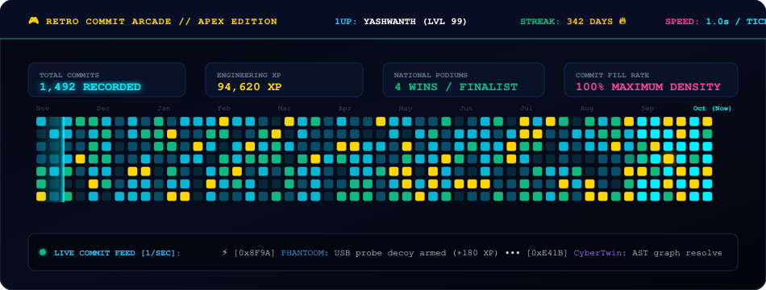
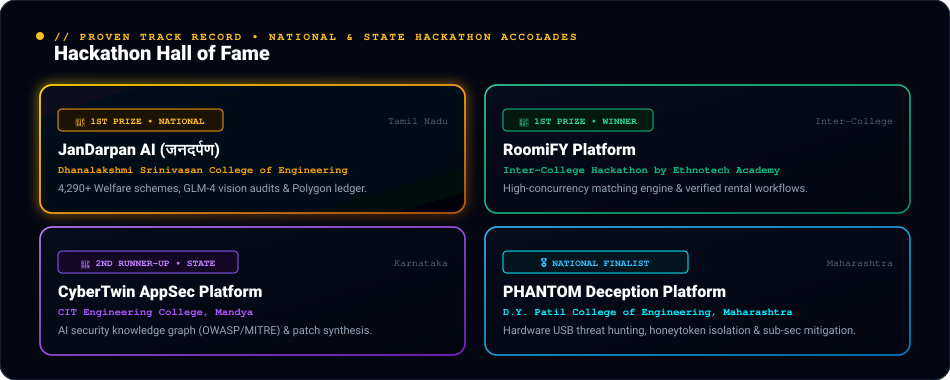
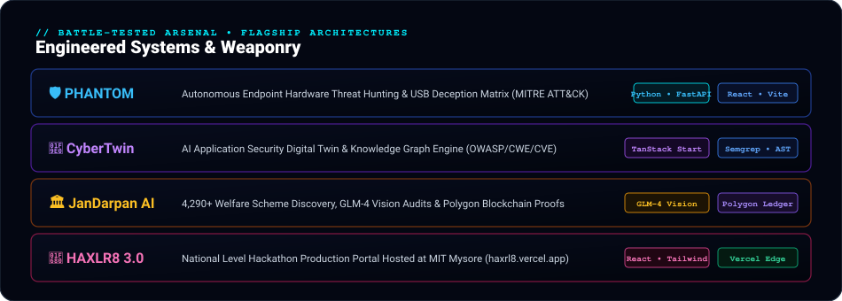
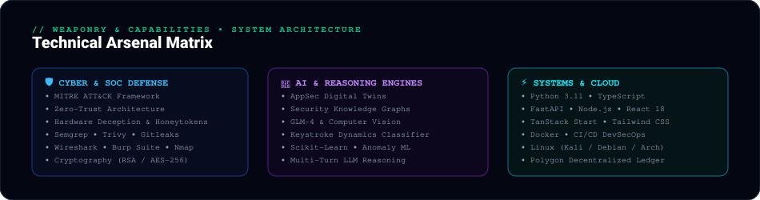

<div align="center">

<!-- APEX CYBERNETIC HUD BANNER -->
<p align="center">
  
</p>

<!-- ACTION HUBS -->
<p align="center">
  <a href="https://github.com/yashuhb18?tab=repositories">
    
  </a>
  <a href="https://haxrl8.vercel.app" target="_blank">
    
  </a>
  <a href="mailto:yashwanthhb18@gmail.com">
    
  </a>
</p>

</div>

---

### `01` // RETRO COMMIT ARCADE & LIVE TELEMETRY MATRIX

<p align="center">
  
</p>

---

### `02` // HALL OF FAME • NATIONAL & STATE HACKATHON ACCOLADES

<p align="center">
  
</p>

---

### `03` // MISSION CONTROL & TELEMETRY

```bash
yashwanth@batcave:~$ ./threat_defense_daemon --apex-mode

  [+] OPERATOR       :: Yashwanth H B
  [+] ALIAS          :: The Silent Architect
  [+] ORIGIN         :: Maharaja Institute of Technology, Mysore
  [+] BRANCH         :: Electronics & Communication Engineering (ECE)
  [+] HONORS         :: 🥇 1st Prize National Champion (TN) • 🥇 1st Prize Ethnotech • 🥉 2nd RU CIT Mandya
  [+] ACTIVE CORE    :: Zero-Trust Hardware Deception • AI AppSec Digital Twins • DevSecOps
  [+] SYSTEM UPTIME  :: 24/7 Continuous Deployment & Real-Time Threat Mitigation
```

> **"Assume breach. Deceive adversaries at the hardware boundary. Synthesize living knowledge models instead of parsing static scanner fatigue."**  
> I engineer defense platforms where hardware telemetry meets artificial intelligence. From mitigating unauthorized peripheral injection within sub-seconds (`PHANTOM`) to reasoning over structural attack graphs (`CyberTwin`) and building national hackathon systems (`HAXLR8`), my focus is creating resilient, battle-tested software.

---

### `04` // BATTLE-TESTED ARSENAL & SYSTEMS

<p align="center">
  
</p>

<p align="center">
  <a href="https://github.com/yashuhb18/PHANTOOM"><b>[ PHANTOM Source ]</b></a> &nbsp;&nbsp;•&nbsp;&nbsp;
  <a href="https://github.com/yashuhb18/CyberTwin"><b>[ CyberTwin Source ]</b></a> &nbsp;&nbsp;•&nbsp;&nbsp;
  <a href="https://github.com/yashuhb18/JanDarpan-Breaking-Bad"><b>[ JanDarpan AI Source ]</b></a> &nbsp;&nbsp;•&nbsp;&nbsp;
  <a href="https://haxrl8.vercel.app"><b>[ HAXLR8 3.0 Live ]</b></a> &nbsp;&nbsp;•&nbsp;&nbsp;
  <a href="https://medi-link-six-snowy.vercel.app"><b>[ MediLink Live ]</b></a>
</p>

---

### `05` // CAPABILITIES & WEAPONRY MATRIX

<p align="center">
  
</p>

---

### `06` // CORE SECURITY METHODOLOGY

```python
class AutonomousDefenseDoctrine:
    """
    Zero-Trust Hardware Deception & AI Reasoning Protocol
    """
    def __init__(self):
        self.posture = "Zero Trust Peripheral Interception"
        self.reasoner = "Security Knowledge Graph (OWASP / CWE / CAPEC)"
        self.verification = "Cryptographic Proofs & Blockchain Immutability"

    def active_hunt(self):
        while True:
            vector = self.intercept_usb_peripheral_probe()
            decoy = self.deploy_honeytoken_trap(vector)
            patch = self.synthesize_verified_remediation(decoy)
            yield patch.enforce()
```

- ⚡ **Sub-Second Physical Neutralisation**: Neutralizing BadUSB, malicious dongles, and input injection before user-space memory hooks execute.
- 🧠 **Graph Reasoners Over Tool Fatigue**: Ingesting code bases into living digital twins with automated patch verification.
- 🏛️ **Real-World Civic Scale**: Translating engineering into social empowerment for millions via accessible AI engines.

---

### `07` // INITIATE ENCRYPTED HANDSHAKE

<div align="center">

Ready to collaborate on **autonomous security systems, AI-driven defense, national hackathons, or high-scale software engineering**?

<br/>

<a href="mailto:yashwanthhb18@gmail.com">
  
</a>
<a href="https://github.com/yashuhb18">
  
</a>
<a href="https://haxrl8.vercel.app" target="_blank">
  
</a>

<br/><br/>

<sub>🛡️ Engineered &amp; Battle-Hardened by <b>Yashwanth H B</b> • National Hackathon Champion • © 2026</sub>

</div>
