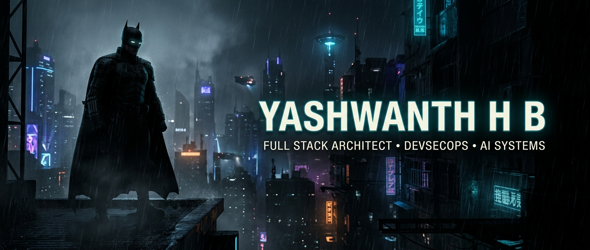
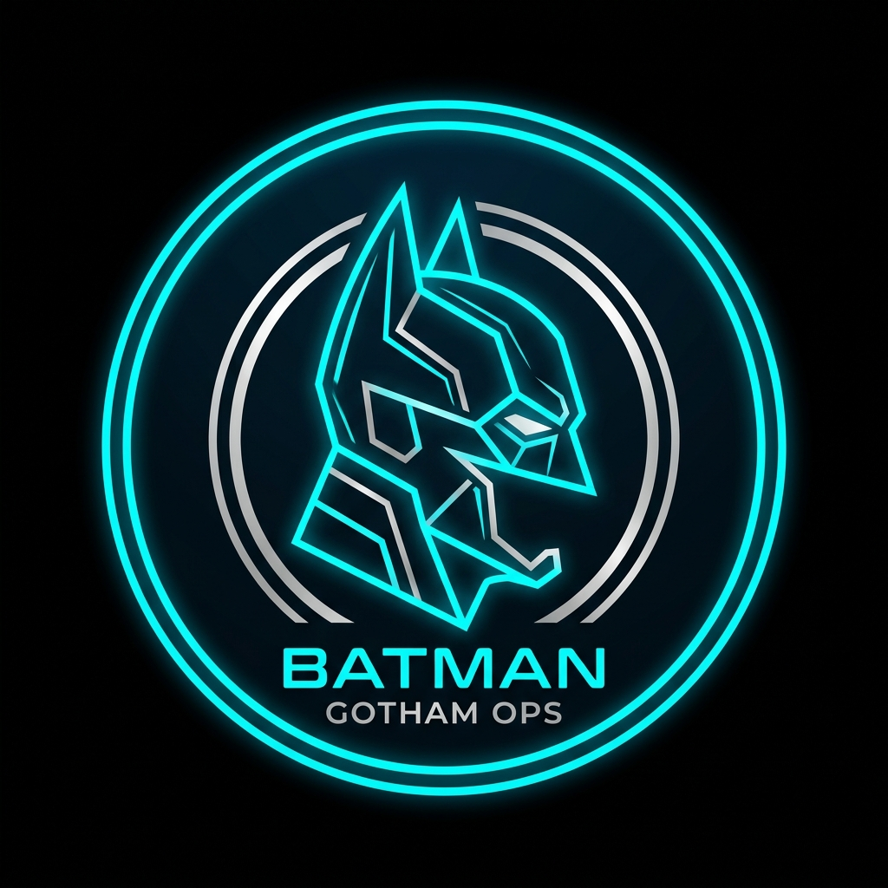
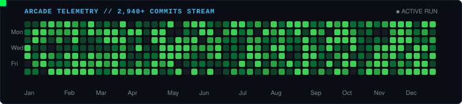

  <!-- Cinematic Header Banner -->
  

    

  <!-- Tagline / Philosophy Statement (Reference 1 style) -->
  

    <em>Transforming complex telemetry and raw code into resilient architectures, threat deception engines, and high-impact digital experiences.</em>
     
    <strong>Currently deep-diving into AI Systems, Application Security Digital Twins, and Full-Stack Engineering.</strong>
  

  <!-- Sleek Connect Pill Badges (Reference 1 style) -->
  

    
    &nbsp;
    
    &nbsp;
    
    &nbsp;
    
  

<!-- Two-Column Split About Section (Reference 1 + Reference 2 style) -->
<table>
  <tr>
    <td width="68%" valign="top">
      <h3>Hey there, I'm Yashwanth aka Yash 🦇</h3>
      

        Electronics &amp; Communication Engineering (ECE) scholar at <strong>Maharaja Institute of Technology, Mysore</strong>. I specialize in building mission-critical full-stack platforms, autonomous hardware threat-hunting architectures, and AI forensic audit engines.
      

      <ul>
        <li>🚀 <strong>What I Build:</strong> High-performance distributed web apps, threat deception pipelines &amp; cyber defense twins.</li>
        <li>🏆 <strong>Hackathon Record:</strong> 4x National &amp; State Level Champion — turning complex problem statements into functional, judged products in 24–36 hour sprints.</li>
        <li>🛡️ <strong>Security Focus:</strong> Hardware-level telemetry, MITRE ATT&amp;CK threat mapping, keystroke anomaly detection &amp; DevSecOps CI/CD.</li>
        <li>⚡ <strong>Tech Philosophy:</strong> Clean architecture, zero bloat, relentless optimization, and defensive engineering by default.</li>
        <li>🎮 <strong>Beyond Code:</strong> Reverse engineering firmware, tactical gaming, and exploring next-generation AI agent frameworks.</li>
      </ul>
    </td>
    <td width="32%" align="center" valign="middle">
      
       
      GOTHAM PROTOCOL // SECURE
    </td>
  </tr>
</table>

 

<!-- 🏆 Hackathon Hall of Fame Section -->
### 🏆 Hackathon Hall of Fame & Victories

> *"Battle-tested across national and state arenas — conceptualizing, architecting, and winning under high-stakes hackathon timers."*

<table>
  <thead>
    <tr>
      <th>Place</th>
      <th>Project</th>
      <th>Event &amp; Venue</th>
      <th>Key Innovation</th>
    </tr>
  </thead>
  <tbody>
    <tr>
      <td align="center">🥇 <strong>1st Prize</strong></td>
      <td><strong>JanDarpan</strong></td>
      <td><strong>National Level Hackathon</strong> <em>Dhanalakshmi Srinivasan College, Tamil Nadu</em></td>
      <td>Citizen Governance &amp; AI Forensic Audit Engine auditing <strong>4,290+ government schemes</strong> with GLM-4 &amp; Polygon blockchain ledger.</td>
    </tr>
    <tr>
      <td align="center">🥇 <strong>1st Prize</strong></td>
      <td><strong>RoomiFY</strong></td>
      <td><strong>Inter-College Hackathon</strong> <em>Ethnotech Academy</em></td>
      <td>Smart roommate discovery &amp; verified accommodation network featuring multi-factor compatibility scoring.</td>
    </tr>
    <tr>
      <td align="center">🥉 <strong>2nd Runner Up</strong></td>
      <td><strong>CyberTwin</strong></td>
      <td><strong>State Level Hackathon</strong> <em>CIT Engineering College, Mandya</em></td>
      <td>AI-Powered Application Security Digital Twin constructing real-time knowledge graphs of vulnerabilities and attack vectors.</td>
    </tr>
    <tr>
      <td align="center">🎯 <strong>Shortlisted</strong></td>
      <td><strong>PHANTOM</strong></td>
      <td><strong>National Level Hackathon</strong> <em>DY Patil College of Engineering, Maharashtra</em></td>
      <td>Autonomous Hardware Threat Hunting &amp; Deception Platform mapped to the MITRE ATT&amp;CK matrix with decoy telemetry.</td>
    </tr>
  </tbody>
</table>

 

<!-- 🚀 Flagship Projects / Arsenal -->
### 🚀 Flagship Projects & Deployed Systems

<table>
  <tr>
    <td width="50%" valign="top">
      <h4>🛡️ <a href="https://github.com/yashuhb18/PHANTOOM">PHANTOM</a></h4>
      
<em>Autonomous Hardware Threat Hunting &amp; Deception Platform</em>

      <ul>
        <li>Real-time telemetry capture &amp; hardware canary decoys.</li>
        <li>Automated MITRE ATT&amp;CK tactic mapping &amp; evasion detection.</li>
      </ul>
      

        <code>Python</code> <code>FastAPI</code> <code>React</code> <code>MITRE ATT&amp;CK</code>
      

    </td>
    <td width="50%" valign="top">
      <h4>🌐 <a href="https://github.com/yashuhb18/CyberTwin">CyberTwin</a></h4>
      
<em>AI-Powered AppSec Digital Twin &amp; Knowledge Graph</em>

      <ul>
        <li>Generates dynamic structural twins of live applications.</li>
        <li>Simulates adversary attack paths before code hits production.</li>
      </ul>
      

        <code>TypeScript</code> <code>TanStack</code> <code>FastAPI</code> <code>AI Graph</code>
      

    </td>
  </tr>
  <tr>
    <td width="50%" valign="top">
      <h4>🏛️ <a href="https://github.com/yashuhb18/JanDarpan-Breaking-Bad">JanDarpan</a></h4>
      
<em>Citizen Governance &amp; AI Forensic Audit Engine</em>

      <ul>
        <li>Cross-examines 4,290+ government schemes for leakages.</li>
        <li>Polygon blockchain proof-of-audit timestamping.</li>
      </ul>
      

        <code>GLM-4 AI</code> <code>Polygon</code> <code>Node.js</code> <code>React</code>
      

    </td>
    <td width="50%" valign="top">
      <h4>🏠 <a href="https://github.com/yashuhb18/RoomiFY">RoomiFY</a></h4>
      
<em>Smart Accommodation &amp; Roommate Intelligence</em>

      <ul>
        <li>Intelligent preference matching engine for students.</li>
        <li>Secure verification pipeline and real-time messaging.</li>
      </ul>
      

        <code>TypeScript</code> <code>React</code> <code>TailwindCSS</code> <code>REST</code>
      

    </td>
  </tr>
  <tr>
    <td width="50%" valign="top">
      <h4>⚡ <a href="https://haxrl8.vercel.app" target="_blank">Haxrl8</a> <code>LIVE</code></h4>
      
<em>National Level Hackathon Organization Portal</em>

      <ul>
        <li>High-throughput team registration and project submission portal.</li>
        <li>Production deployment serving live participants.</li>
      </ul>
      

        <code>React</code> <code>Vercel</code> <code>Full-Stack</code>
      

    </td>
    <td width="50%" valign="top">
      <h4>🏥 <a href="https://medi-link-six-snowy.vercel.app" target="_blank">MediLink</a> <code>LIVE</code></h4>
      
<em>Decentralized Healthcare Connectivity Platform</em>

      <ul>
        <li>Bridging healthcare providers, patients, and real-time consultations.</li>
        <li>Live cloud production deployment.</li>
      </ul>
      

        <code>JavaScript</code> <code>React</code> <code>Cloud APIs</code>
      

    </td>
  </tr>
</table>

 

<!-- 🧩 Languages & Tools (Reference 2 style) -->
### 🧩 Languages &amp; Tools I Work With

  
<strong>CORE LANGUAGES</strong>

  

    

  
<strong>FRAMEWORKS &amp; FULL STACK</strong>

  

    

  
<strong>DEVSECOPS, CLOUD &amp; ARCHITECTURE</strong>

  

 

<!-- 📊 GitHub Telemetry & Stats (Reference 2 style) -->
### 📊 GitHub Activity &amp; Telemetry

  
  &nbsp;&nbsp;
  

 

  

 

<!-- 🎮 The Commit Arcade (Gamified experience connecting to index.html) -->
### 🎮 The Commit Arcade &amp; Live Terminal

  
<em>Experience the live 1-commit/sec streaming engine, interactive terminal CLI, and particle canvas on the official web portal:</em>

  
  &nbsp;
  

    

  <!-- Dark snake contribution arcade animation -->
  

 

<!-- Footer / Quote (Reference 2 style) -->

  

    <em>"It's not who I am underneath, but what I build that defines me."</em> 🦇
  

  

    ⚡ Designed &amp; Engineered by <strong>Yashwanth H B</strong> • Mysore, India 🇮🇳
  

